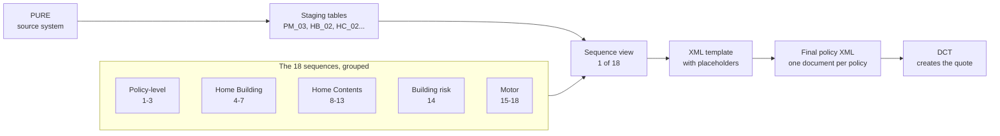

# What each of the 18 sequences actually does

*PP Conversion · Plain-English Guide*

## How this pipeline works, in one paragraph

Every night, the conversion reads a snapshot of PURE's policy data and rebuilds a set of staging tables in Snowflake (things like `PM_03` for vehicles, `HB_02`/`HC_02` for home coverage). Each of the 18 “sequences” below takes one of those staging tables, runs it through a small SQL *view* that cleans up and reshapes the values, then stamps those values into a fixed XML template — wherever the template has a `{TOKEN_NAME}` placeholder, the matching column's value gets substituted in. The 18 sequences' outputs are then stitched together into one big XML document per policy and handed to DCT, which is the system that actually creates the quote/policy.

**Data flow:** PURE (source of truth) → Staging tables (rebuilt fresh each run) → Sequence view (1 of 18) → XML template with {tokens} → Final policy XML → DCT



> **Note:** A few things repeat across many sequences: `{INDICATOR}` is almost always a 1/0 flag for “was this option taken,” `{DESCRIPTION}` is a human-readable label, and `{EXP_PREM}`/`{...CLMINCD}`/`{...CLMCNT}` carry the premium and claims-history numbers used for pricing.

---

## Policy-level information

Not tied to a specific coverage — these describe the policy or customer as a whole.

### SEQ 1 — Claims History

For every past claim on this policy, we send DCT one line: when it happened, how much was paid, and why. Underwriting uses this claims history to help price the new policy — a customer with several at-fault claims is a different risk than one with none.

**Reads from:** AGGNE.DEV.PER_VW_CLAIM_HISTORY → **Becomes:** AGGNE.DEV.PER_CLAIM_HISTORY_TARGET

**Tokens**

| Token | Plain meaning |
|---|---|
| `{DATEOFCLAIM}` | The date the claim happened |
| `{AMOUNTPAID}` | How much was paid out on that claim |
| `{LINE}` | Which type of coverage the claim was against |
| `{CAUSE}` | Why the claim happened (at-fault, theft, fire, flood, etc.) |

**Hardcoded / fixed values in this template** — these fields never vary by policy; the same literal value is sent every time.

| Field | Fixed value |
|---|---|
| `<Source>` | Always sent as `Perf` |

**What the XML looks like (live, seq 1)**

```xml
<losshistory>
  <DateOfClaim>{DATEOFCLAIM}</DateOfClaim>
  <AmmountPaid>{AMOUNTPAID}</AmmountPaid>
  <Line>{LINE}</Line>
  <Cause>{CAUSE}</Cause>
  <Source>Perf</Source>
</losshistory>
```

### SEQ 2 — Prior Insurer

Tells DCT who insured this customer before us, and what they were paying. One row per policy — it's the “who did you switch from, and at what price” information shown on the quote screen.

**Reads from:** AGGNE.DEV.PER_VW_CBP_COMPETITOR_INFORMATION → **Becomes:** AGGNE.DEV.PER_COMPETITOR_INFORMATION_TARGET

**Tokens**

| Token | Plain meaning |
|---|---|
| `{PRIORCARRIER}` | Name of the previous insurance company |
| `{PRICE}` | What the customer was paying before |

**What the XML looks like (live, seq 2)**

```xml
<priorinsuranceinfo>
  <PriorCarrier>{PRIORCARRIER}</PriorCarrier>
  <Price>{PRICE}</Price>
</priorinsuranceinfo>
```

### SEQ 3 — Locations

One row per physical address tied to the policy — the “where does this risk actually sit” information. A policy can have more than one location (e.g. two rental properties on one Home Building policy).

**Reads from:** AGGNE.DEV.PER_ACCOUNT_LOC → **Becomes:** AGGNE.DEV.PER_ACCOUNT_LOC_TARGET

**Tokens**

| Token | Plain meaning |
|---|---|
| `{RISKNUMBER}` | An internal number identifying this location |
| `{STATE}` | State/territory the address is in |
| `{ADDRESS1}` | Street address |
| `{SUBURB}` | Suburb/city |
| `{POSTCODE}` | Postcode |
| `{LOC_COUNTRY}` | Country (AU or NZ) |
| `{ADDRESSOVERRIDE}` | Tells DCT to accept this address even if its own validator doesn't recognize it — needed because converted addresses don't always pass DCT's own address-lookup check |

**Hardcoded / fixed values in this template** — these fields never vary by policy; the same literal value is sent every time.

| Field | Fixed value |
|---|---|
| `<GeocodeStatusDisplay>` | Always sent as `Unverified` |
| `<AddressVerified>` | Always sent as `0` |

> ⚠️ **Always empty (3)** these fields exist in the template but nothing in our pipeline populates them yet — they go to DCT as empty tags: `Address2`, `BusinessType`, `LocationType`

**What the XML looks like (live, seq 3)**

```xml
<location>
  <Number>{RISKNUMBER}</Number>
  <address>
    <State>{STATE}</State>
    <Address1>{ADDRESS1}</Address1>
    <Address2></Address2>
    <City>{SUBURB}</City>
    <ZipCode>{POSTCODE}</ZipCode>
    <Country>{LOC_COUNTRY}</Country>
  </address>
  <GeocodeStatusDisplay>Unverified</GeocodeStatusDisplay>
  <LocationType/>
  <BusinessType/>
  <AddressOverride>{ADDRESSOVERRIDE}</AddressOverride>
  <AddressVerified>0</AddressVerified>
</location>
```

---

## Home Building

Covers the physical structure itself. Sequences 4–7 all describe the Home Building side of a policy — from the small optional extras up to the main coverage block.

### SEQ 4 — Home Building Extras

The optional add-ons a customer can attach to their Home Building coverage — things like accidental damage cover or flood protection. One row per possible extra, each marked as taken or not.

**Reads from:** AGGNE.DEV.PER_BB_SUBCOVERAGES → **Becomes:** AGGNE.DEV.PER_BUILDING_TARGET

**Tokens**

| Token | Plain meaning |
|---|---|
| `{TYPE} / {CODE}` | Which extra this is (an internal code) |
| `{DESCRIPTION}` | Human-readable name of the extra |
| `{INDICATOR}` | 1 if the customer took this extra, 0 if not |
| `{IVALUE}` | The dollar limit for this extra, if it has one |
| `{SVALUE}` | A status value for this extra (e.g. Taken/NotTaken), where applicable |
| `{EXP_PREM}` | How much of the premium this specific extra contributes |

**What the XML looks like (live, seq 4)**

```xml
<coverage>
  <Type>{TYPE}</Type>
  <limit>
    <Type>{TYPE}</Type>
    <iValue>{IVALUE}</iValue>
  </limit>
  <Indicator>{INDICATOR}</Indicator>
  {SVALUE}
  <Code>{CODE}</Code>
  <Description>{DESCRIPTION}</Description>
  <Premium>{EXP_PREM}</Premium>
</coverage>
```

### SEQ 5 — Home Building Adjustments

Manual pricing tweaks an underwriter applied by hand — a loading (surcharge) or a discount, with a note explaining why.

**Reads from:** AGGNE.DEV.BUILDING_UW → **Becomes:** AGGNE.DEV.PER_BUILDING_TARGET

**Tokens**

| Token | Plain meaning |
|---|---|
| `{COVERAGE}` | Which coverage this adjustment applies to |
| `{ADJUSTMENTSELECTION}` | Whether the adjustment is a dollar amount or a percentage |
| `{ADJUSTMENTDOLLARANDPERCENT}` | The actual size of the adjustment |
| `{RECURRINGINDICATOR}` | Whether this adjustment applies every renewal, or just once |
| `{UNDERWRITINGDESCRIPTION}` | The underwriter's note explaining the adjustment |

> ⚠️ **Always empty (1)** these fields exist in the template but nothing in our pipeline populates them yet — they go to DCT as empty tags: `AdjustmentAmount`

**What the XML looks like (live, seq 5)**

```xml
<UnderwritingAdjustment>
  <Type>{COVERAGE}</Type>
  <AdjustmentSelection>{ADJUSTMENTSELECTION}</AdjustmentSelection>
  <AdjustmentDollarAndPercent>{ADJUSTMENTDOLLARANDPERCENT}</AdjustmentDollarAndPercent>
  <AdjustmentAmount></AdjustmentAmount>
  <Recurring>
    <Indicator>{RECURRINGINDICATOR}</Indicator>
  </Recurring>
  <UnderwritingDescription>{UNDERWRITINGDESCRIPTION}</UnderwritingDescription>
</UnderwritingAdjustment>
```

### SEQ 6 — Home Building Clauses

Special wording that gets attached to the policy schedule — endorsements that change or clarify what's covered, printed on the customer's documents.

**Reads from:** AGGNE.DEV.HB_CLAUSE → **Becomes:** AGGNE.DEV.PER_BUILDING_TARGET

**Tokens**

| Token | Plain meaning |
|---|---|
| `{DCCLAUSETYPE}` | Which specific clause this is (an internal code DCT recognizes) |
| `{DCINPUT}` | The actual wording text shown to the customer |

**Hardcoded / fixed values in this template** — these fields never vary by policy; the same literal value is sent every time.

| Field | Fixed value |
|---|---|
| `<Indicator>` | Always sent as `1` |
| `<DisableFlag>` | Always sent as `1` |

**What the XML looks like (live, seq 6)**

```xml
<Clause>
  <Type>{DCCLAUSETYPE}</Type>
  <Indicator>1</Indicator>
  <Description>{DCINPUT}</Description>
  <DisableFlag>1</DisableFlag>
</Clause>
```

### SEQ 7 — Home Building Coverage Block

The main Home Building section itself — how much the building is insured for, what the excess is, whether it's a rental property and landlord protections apply, plus the claims history and premium for this coverage. Everything from sequences 4 and 6 gets folded into this block too.

**Reads from:** AGGNE.DEV.PER_HOME_BUILDING_PAYLOAD → **Becomes:** AGGNE.DEV.PER_BUILDING_TARGET

**Tokens**

| Token | Plain meaning |
|---|---|
| `{HB_INDICATOR}` | 1 if Home Building cover was actually selected on this policy |
| `{HOMEBUILDINGSLIMIT}` | The sum insured for the building |
| `{VOLUNTARYEXCESS}` | The excess the customer chose to pay less premium |
| `{ACCIDENTALLOSSORDAMAGE}` | Whether accidental damage cover was taken |
| `{LANDLORDPROTECTIONS}` | Whether landlord protection cover was taken (rental properties) |
| `{MINIMUMRENTALPERIOD} / {WEEKLYRENT}` | Rental details, only relevant when landlord protection is on |
| `{HB_CLAUSE}` | Slots in all of Sequence 6's clause text for this policy |
| `{HBCLMINCD} / {HBCLMCNT}` | Total claims paid and number of claims, from Sequence 1's history |
| `{EXPPREM}` | The premium for this Home Building coverage |
| `{HB_UW}` | Slots in this policy's Home Building underwriting adjustment (loading/discount) block, if one exists |
| `{HB_UW_INDICATOR}` | 1 if this policy has a real Home Building underwriting adjustment, 0 if not |

**Hardcoded / fixed values in this template** — these fields never vary by policy; the same literal value is sent every time.

| Field | Fixed value |
|---|---|
| `<Type>` | Always sent as `Building` |
| `<SetExcessAmount>` | Always sent as `0` |
| `<CoverageLevel>` | Always sent as `Per Occurrence` |
| `<LossOfRentLimit>` | Always sent as `0` |
| `<Code>` | Always sent as `HB` |
| `<APRA>` | Always sent as `FISR` |
| `<Business>` | Always sent as `BSP` |

> ⚠️ **Always empty (6)** these fields exist in the template but nothing in our pipeline populates them yet — they go to DCT as empty tags: `Amount`, `Earthquake`, `Flood`, `Glass`, `Imposed`, `Standard`

**What the XML looks like (live, seq 7)**

```xml
<coverage>
  <Type>Building</Type>
  <Excess>
    <Amount/>
    <Imposed/>
    <Flood/>
    <Voluntary>{VOLUNTARYEXCESS}</Voluntary>
    <Earthquake/>
    <Standard/>
    <Glass/>
  </Excess>
  <SetExcessAmount>0</SetExcessAmount>
  <Indicator>{HB_INDICATOR}</Indicator>
  <CoverageLevel>Per Occurrence</CoverageLevel>
  <LossOfRentLimit>0</LossOfRentLimit>
  <Glass/>
  <AccidentalLossOrDamage>{ACCIDENTALLOSSORDAMAGE}</AccidentalLossOrDamage>
  <UWAdjustmentIndicator>{HB_UW_INDICATOR}</UWAdjustmentIndicator>
  <GlassLimit>{HOMEBUILDINGSLIMIT}</GlassLimit>
  <Code>HB</Code>
  <LandlordProtections>{LANDLORDPROTECTIONS}</LandlordProtections>
  <MinimumRentalPeriod>{MINIMUMRENTALPERIOD}</MinimumRentalPeriod>
  <WeeklyRent>{WEEKLYRENT}</WeeklyRent>
  <ClassCode>
    <APRA>FISR</APRA>
    <Business>BSP</Business>
  </ClassCode>
  {HB_CLAUSE}{HB_UW}
  <ClaimsIncurred>{HBCLMINCD}</ClaimsIncurred>
  <NumberOfClaims>{HBCLMCNT}</NumberOfClaims>
  <Premium>{EXPPREM}</Premium>
</coverage>
```

---

## Home Contents

Covers what's inside the building — furniture, valuables, personal items. Sequences 8–13 mirror the Home Building structure above, but for contents.

### SEQ 8 — Contents Items Over the Standard Limit

Lists individual belongings worth more than the automatic contents limit — things like jewellery or art that need to be separately declared to be fully covered.

**Reads from:** AGGNE.DEV.PER_HC_ITEMS_EXCEED_VALUE → **Becomes:** AGGNE.DEV.PER_HC_TARGET

**Tokens**

| Token | Plain meaning |
|---|---|
| `{DESCRIPTION}` | What the item is |
| `{VALUE}` | What it's worth |

**What the XML looks like (live, seq 8)**

```xml
<HomeContents>{VALUE}
		{DESCRIPTION}</HomeContents>
```

### SEQ 9 — Specifically Scheduled Contents

Similar to Sequence 8, but for items the customer has chosen to individually list and insure by name, with their own agreed value.

**Reads from:** AGGNE.DEV.PER_HC_SPECIFIEDCONTENTS → **Becomes:** AGGNE.DEV.PER_HC_TARGET

**Tokens**

| Token | Plain meaning |
|---|---|
| `{DESCRIPTION}` | What the item is |
| `{VALUE}` | Its agreed value |

**What the XML looks like (live, seq 9)**

```xml
<SpecifiedContents>{VALUE}
		{DESCRIPTION}</SpecifiedContents>
```

### SEQ 10 — Home Contents Extras

Same idea as Sequence 4, but the optional add-ons for Home Contents — e.g. flood cover for contents, or unlimited glass.

**Reads from:** AGGNE.DEV.PER_HC_SUBCOVERAGES → **Becomes:** AGGNE.DEV.PER_HC_TARGET

**Tokens**

| Token | Plain meaning |
|---|---|
| `{TYPE} / {CODE} / {DESCRIPTION}` | Which extra this is and its label |
| `{INDICATOR}` | 1 if taken, 0 if not |
| `{IVALUE} / {SVALUE}` | Limit / status for this extra |
| `{EXP_PREM}` | Premium contribution from this extra |

**What the XML looks like (live, seq 10)**

```xml
<coverage>
  <Type>{TYPE}</Type>
  <limit>
    <Type>{TYPE}</Type>
    <iValue>{IVALUE}</iValue>
  </limit>
  <Indicator>{INDICATOR}</Indicator>
  {SVALUE}
  <Code>{CODE}</Code>
  <Description>{DESCRIPTION}</Description>
  <Premium>{EXP_PREM}</Premium>
</coverage>
```

### SEQ 11 — Home Contents Adjustments

Manual underwriter pricing tweaks for the Contents coverage — same idea as Sequence 5.

**Reads from:** AGGNE.DEV.PER_HC_BUILDING_UW → **Becomes:** AGGNE.DEV.PER_HC_TARGET

**Tokens**

| Token | Plain meaning |
|---|---|
| `{COVERAGE} / {ADJUSTMENTSELECTION} / {ADJUSTMENTDOLLARANDPERCENT}` | What the adjustment applies to, dollar-or-percent, and its size |
| `{RECURRINGINDICATOR}` | Every renewal, or one-off |
| `{UNDERWRITINGDESCRIPTION}` | Underwriter's note |

> ⚠️ **Always empty (1)** these fields exist in the template but nothing in our pipeline populates them yet — they go to DCT as empty tags: `AdjustmentAmount`

**What the XML looks like (live, seq 11)**

```xml
<UnderwritingAdjustment>
  <Type>{COVERAGE}</Type>
  <AdjustmentSelection>{ADJUSTMENTSELECTION}</AdjustmentSelection>
  <AdjustmentDollarAndPercent>{ADJUSTMENTDOLLARANDPERCENT}</AdjustmentDollarAndPercent>
  <AdjustmentAmount></AdjustmentAmount>
  <Recurring>
    <Indicator>{RECURRINGINDICATOR}</Indicator>
  </Recurring>
  <UnderwritingDescription>{UNDERWRITINGDESCRIPTION}</UnderwritingDescription>
</UnderwritingAdjustment>
```

### SEQ 12 — Home Contents Clauses

Special wording attached to the Contents section, same idea as Sequence 6.

**Reads from:** AGGNE.DEV.PER_HC_CLAUSE → **Becomes:** AGGNE.DEV.PER_HC_TARGET

**Tokens**

| Token | Plain meaning |
|---|---|
| `{DCCLAUSETYPE}` | Which clause |
| `{DCINPUT}` | The wording text |

**Hardcoded / fixed values in this template** — these fields never vary by policy; the same literal value is sent every time.

| Field | Fixed value |
|---|---|
| `<Indicator>` | Always sent as `1` |
| `<DisableFlag>` | Always sent as `1` |

**What the XML looks like (live, seq 12)**

```xml
<Clause>
  <Type>{DCCLAUSETYPE}</Type>
  <Indicator>1</Indicator>
  <Description>{DCINPUT}</Description>
  <DisableFlag>1</DisableFlag>
</Clause>
```

### SEQ 13 — Home Contents Coverage Block

The main Contents section — sum insured, excess, flood cover status, and whether any items-over-value or specified items apply, plus claims history and premium. Folds in Sequences 8, 9, 10 and 12.

**Reads from:** AGGNE.DEV.PER_HOME_BUILDING_PAYLOAD → **Becomes:** AGGNE.DEV.PER_HC_TARGET

**Tokens**

| Token | Plain meaning |
|---|---|
| `{HC_INDICATOR}` | 1 if Home Contents cover was selected |
| `{FLOODDAMAGE}` | Whether flood cover was taken |
| `{VOLUNTARYEXCESS} / {ACCIDENTALLOSSORDAMAGE}` | Chosen excess / accidental damage status |
| `{ANYITEMSEXCEEDVALUE}` | Whether any items are over the standard limit (Sequence 8) |
| `{SPECIFIEDITEMSAWAY} / {UNSPECIFIEDITEMSAWAY} / {UNSPECIFIEDITEMSAWAYLIMIT}` | Cover for items taken away from the home |
| `{HC_EXCEED_VALUES} / {HC_SPECIFIED_CONTENTS}` | Slots in Sequence 8's and 9's item lists |
| `{SUBCOV}` | Slots in Sequence 10's extras |
| `{HC_CLAUSE}` | Slots in Sequence 12's clause text |
| `{UW}` | Slots in Sequence 11's adjustments |
| `{HCCLMINCD} / {HCCLMCNT}` | Claims paid / claim count |
| `{HBEXPPREM}` | The premium for this Contents coverage |

**Hardcoded / fixed values in this template** — these fields never vary by policy; the same literal value is sent every time.

| Field | Fixed value |
|---|---|
| `<Type>` | Always sent as `ContentsAndStocks` |
| `<CoverageLevel>` | Always sent as `Per Occurrence` |
| `<Code>` | Always sent as `HC` |
| `<APRA>` | Always sent as `FISR` |
| `<Business>` | Always sent as `BSP` |

**Always empty (16 fields) — nothing in our pipeline populates these yet**

`CustomersVehiclesLimit`, `CustomersWatercraftUnder8mLimit`, `Earthquake`, `EmployeeToolsofTradeLimit`, `Flood`, `Hail`, `HailDamagetoVehiclesorWatercraftsInStockLimit`, `HomeContentsTotal`, `Imposed`, `MotorFuelsLimit`, `PersonalEffectsLimit`, `SpecifiedContentsTotal`, `Standard`, `StockLimitExcludingVehiclesWatercraft`, `VehiclesInStockLimit`, `WatercraftInStockUnder8mLimit`

**What the XML looks like (live, seq 13)**

```xml
<coverage>
  <Type>ContentsAndStocks</Type>
  <Indicator>{HC_INDICATOR}</Indicator>
  <CoverageLevel>Per Occurrence</CoverageLevel>
  <FloodDamage>{FLOODDAMAGE}</FloodDamage>
  <Excess>
    <Flood/>
    <Earthquake/>
    <Imposed/>
    <Voluntary>{VOLUNTARYEXCESS}</Voluntary>
    <Standard/>
    <Hail/>
  </Excess>
  <StockLimitExcludingVehiclesWatercraft/>
  <EmployeeToolsofTradeLimit/>
  <PersonalEffectsLimit/>
  <MotorFuelsLimit/>
  <VehiclesInStockLimit/>
  <CustomersVehiclesLimit/>
  <WatercraftInStockUnder8mLimit/>
  <CustomersWatercraftUnder8mLimit/>
  <HailDamagetoVehiclesorWatercraftsInStockLimit/>
  <Code>HC</Code>
  <AccidentalLossOrDamage>{ACCIDENTALLOSSORDAMAGE}</AccidentalLossOrDamage>
  <HomeContentsLimits>{ANYITEMSEXCEEDVALUE}</HomeContentsLimits>
  <SpecifiedItemsPremises>{SPECIFIEDITEMSAWAY}</SpecifiedItemsPremises>
  <UnspecifiedItemsAwayPremises>{UNSPECIFIEDITEMSAWAY}</UnspecifiedItemsAwayPremises>
  <UnspecifiedItemsAwayPremisesLimit>{UNSPECIFIEDITEMSAWAYLIMIT}</UnspecifiedItemsAwayPremisesLimit>
  <HomeContentsTotal></HomeContentsTotal>
  <SpecifiedContentsTotal></SpecifiedContentsTotal>
  {HC_EXCEED_VALUES}  {HC_SPECIFIED_CONTENTS}  {SUBCOV}
  <ClassCode>
    <APRA>FISR</APRA>
    <Business>BSP</Business>
  </ClassCode>
  <ClaimsIncurred>{HCCLMINCD}</ClaimsIncurred>
  <NumberOfClaims>{HCCLMCNT}</NumberOfClaims>
  <Premium>{HBEXPPREM}</Premium>
  {HC_CLAUSE}  {UW}
</coverage>
```

---

## Building & Property Risk

Physical construction and security details about the building, used to assess risk — separate from the coverage amounts above.

### SEQ 14 — Building Details

A physical description of the building — what it's made of, how old it is, when the wiring and plumbing were last redone, what security is in place, and who lives there. This is the risk-assessment side, separate from the dollar limits in Sequences 7 and 13.

**Reads from:** AGGNE.DEV.PER_RISK_BUILDING_FINAL → **Becomes:** AGGNE.DEV.PER_RISK_BUILDING_TARGET

**Tokens**

| Token | Plain meaning |
|---|---|
| `{RISKNUMBER}` | Which location this building is at (matches Sequence 3) |
| `{ROOFCONSTRUCTION_FINAL} / {MAINWALLCONSTRUCTION_FINAL} / {FLOORCONSTRUCTION_FINAL}` | What the building is built from |
| `{STOREYS}` | Number of storeys |
| `{YEARBUILDINGCONSTRUCTED}` | Year the building was built |
| `{YEARLASTREWIRED} / {YEARLASTREPLUMBED}` | Year the electrical wiring / plumbing was last replaced |
| `{ALARMSYSTEMINSTALLED_FINAL} / {DEADLOCKSINSTALLED_FINAL} / {GRILLKEYLOCKINSTALLED_FINAL}` | Security features present |
| `{SECURITYDETAILS}` | Free-text security notes |
| `{HOWOCCUPPIED}` | Owner-occupied, tenanted, vacant, etc. |
| `{INTERESTEDPARTY}` | Any third party with a financial interest (e.g. a bank/mortgagee) |
| `{RISK_BC}` | Slots in additional building-construction detail fields, where applicable |
| `{RISK_BUILDING}` | Slots in additional building-risk detail fields, where applicable |

**Hardcoded / fixed values in this template** — these fields never vary by policy; the same literal value is sent every time.

| Field | Fixed value |
|---|---|
| `<Type>` | Always sent as `Building` |
| `<SICCode>` | Always sent as `General Mechanical Workshop` |
| `<Details>` | Always sent as `Building 1` |
| `<IsBuildingHeritage>` | Always sent as `0` |
| `<AmoutOfEPS>` | Always sent as `0` |
| `<ExternalDoors>` | Always sent as `1` |
| `<SecurityAccessibleWindows>` | Always sent as `1` |
| `<SecurityAlarm>` | Always sent as `0` |
| `<VehicleDetails>` | Always sent as `Vehicle 1` |
| `<VehicleYardShowingAnySecurity>` | Always sent as `0` |
| `<VehicleKeyStorage>` | Always sent as `0` |
| `<HireVehicleContractSupplied>` | Always sent as `0` |
| `<LocationConnectedToTownWaterMain>` | Always sent as `0` |
| `<StoreFlammableGoods>` | Always sent as `0` |
| `<IsAusStandardFollowed>` | Always sent as `1` |
| `<TwentyFourHoursAttendanceOnSite>` | Always sent as `0` |
| `<RoofSqmAon>` | Always sent as `0` |

**Always empty (56 fields) — nothing in our pipeline populates these yet**

`AdequateSecurityForOvernightStorage`, `ApproximateReplacementCostOfHighestValueBooth`, `AreHoistsUsedForDismantling`, `AreMetalRecyclingActivitiesConductedInsideABuilding`, `AreSecurityBollardsInPlace`, `AreTheTyresOutsideStoredInAnOrderlyManner`, `AreThereMoreThanAFewTyresStackedUpAgainstTheBuilding`, `AreVehiclesStackedOrRacked`, `AreYourPremisesPatrolledByASecurityGuard`, `AverageNumberOfVehiclesInTheYard`, `ClearLandSqm`, `Condition`, `ConditionOfBuilding`, `ConditionOfRoof`, `Detail`, `DismantlerAreaHousekeeping`, `DismantlerFloorCondition`, `DoYouHaveSecurityCamerasOrCCTVInstalled`, `EvidenceOfInadequateFuelStorageProcedures`, `FireSuppressionEquipmentNearDismantlingAreas`, `HasTheExhaustFanBeenReconditionedOrReplacedInTheLast5yrs`, `HighRiskSpecialisedEquipment`, `HowIsFuelStored`, `ImposedExcess`, `IsBoothInteriorWallProtectionUsed`, `IsExcessiveOilResiduePresentOnTheOutsideGround`, `IsMetalRecyclingConductedOnSite`, `IsTheSurroundingAreaFreeOfAccelerantsAndHeatWork`, `IsThereATwoMeterHighPerimeterFenceEnclosingThePremises`, `IsThereEvidenceOfRegularBoothCleaningOrServicing`, `IsThereExteriorSecurityLighting`, `LandSqm`, `LocationANZSICCode`, `LocationOfDefueling`, `LocationOfDismantlingArea`, `MatchingRestrictions`, `MixingRoomHousekeeping`, `NumberOfSprayBoothsAtThisLocation`, `OccupationOfHighestRiskTenant`, `OldestBoothAgeYears`, `PropertyInputGeocodeURL`, `RoofConstructionAon`, `SatisfactoryRiskMitigationProcessesEvident`, `StandardExcess`, `StockStorageHousekeeping`, `StorageOfEVsAndTheirBatteries`, `SurroundingAreaHousekeeping`, `TyresOrBatteriesStorageHousekeeping`, `VolumeOfTyresStackedInside`, `VolumeOfTyresStackedOutside`, `WhatQuantity`, `WhatYearWasARiskAssessmentReviewLastUndertaken`, `YardFloorOrHousekeeping`, `YearLastReWiredCalculation`, `YearOfLastProfessionalService`, `YearTheBuildingWasLastReRoofed`

**What the XML looks like (live, seq 14)**

```xml
<risk>
  <Type>Building</Type>
  <SICCode>General Mechanical Workshop</SICCode>
  <LocationNumber>{RISKNUMBER}</LocationNumber>
  <NumberOfSprayBoothsAtThisLocation/>
  <Condition/>
  <IsTheSurroundingAreaFreeOfAccelerantsAndHeatWork/>
  <SurroundingAreaHousekeeping/>
  <MixingRoomHousekeeping/>
  <OldestBoothAgeYears/>
  <ApproximateReplacementCostOfHighestValueBooth/>
  <YearOfLastProfessionalService/>
  <IsThereEvidenceOfRegularBoothCleaningOrServicing/>
  <IsBoothInteriorWallProtectionUsed/>
  <HasTheExhaustFanBeenReconditionedOrReplacedInTheLast5yrs/>
  <DismantlerFloorCondition/>
  <DismantlerAreaHousekeeping/>
  <LocationOfDefueling/>
  <LocationOfDismantlingArea/>
  <AreHoistsUsedForDismantling/>
  <FireSuppressionEquipmentNearDismantlingAreas/>
  <IsMetalRecyclingConductedOnSite/>
  <AreMetalRecyclingActivitiesConductedInsideABuilding/>
  <StockStorageHousekeeping/>
  <TyresOrBatteriesStorageHousekeeping/>
  <StorageOfEVsAndTheirBatteries/>
  <AreVehiclesStackedOrRacked/>
  <HowIsFuelStored/>
  <AverageNumberOfVehiclesInTheYard/>
  <YardFloorOrHousekeeping/>
  <ClearLandSqm/>
  <AdequateSecurityForOvernightStorage/>
  <HighRiskSpecialisedEquipment/>
  <Detail/>
  <EvidenceOfInadequateFuelStorageProcedures/>
  <AreThereMoreThanAFewTyresStackedUpAgainstTheBuilding/>
  <VolumeOfTyresStackedOutside/>
  <VolumeOfTyresStackedInside/>
  <AreTheTyresOutsideStoredInAnOrderlyManner/>
  <IsExcessiveOilResiduePresentOnTheOutsideGround/>
  <SatisfactoryRiskMitigationProcessesEvident/>
  <Embargoes>
    <MatchingRestrictions/>
  </Embargoes>
  <StandardExcess></StandardExcess>
  <ImposedExcess></ImposedExcess>
  <Details>Building 1</Details>
  <IsBuildingHeritage>0</IsBuildingHeritage>
  <AmoutOfEPS>0</AmoutOfEPS>
  <ExternalDoors>1</ExternalDoors>
  <SecurityAccessibleWindows>1</SecurityAccessibleWindows>
  <SecurityAlarm>0</SecurityAlarm>
  <VehicleDetails>Vehicle 1</VehicleDetails>
  <VehicleYardShowingAnySecurity>0</VehicleYardShowingAnySecurity>
  <VehicleKeyStorage>0</VehicleKeyStorage>
  <HireVehicleContractSupplied>0</HireVehicleContractSupplied>
  <LocationANZSICCode/>
  <LocationConnectedToTownWaterMain>0</LocationConnectedToTownWaterMain>
  <StoreFlammableGoods>0</StoreFlammableGoods>
  <WhatQuantity/>
  <IsAusStandardFollowed>1</IsAusStandardFollowed>
  {RISK_BUILDING}
	{RISK_BC}
  <RoofConstruction>{ROOFCONSTRUCTION_FINAL}</RoofConstruction>
  <NumberOfStories>{STOREYS}</NumberOfStories>
  <WhatYearWasTheBuildingConstructed>{YEARBUILDINGCONSTRUCTED}</WhatYearWasTheBuildingConstructed>
  <OccupationOfHighestRiskTenant/>
  <YearTheBuildingWasLastReWired>{YEARLASTREWIRED}</YearTheBuildingWasLastReWired>
  <YearTheBuildingWasLastRePlumbed>{YEARLASTREPLUMBED}</YearTheBuildingWasLastRePlumbed>
  <YearTheBuildingWasLastReRoofed></YearTheBuildingWasLastReRoofed>
  <MainWallConstruction>{MAINWALLCONSTRUCTION_FINAL}</MainWallConstruction>
  <FloorConstruction>{FLOORCONSTRUCTION_FINAL}</FloorConstruction>
  <YearLastReWiredCalculation></YearLastReWiredCalculation>
  <WhatTypeOfAlarmSystemIsInstalled>{ALARMSYSTEMINSTALLED_FINAL}</WhatTypeOfAlarmSystemIsInstalled>
  <DoYouHaveSecurityCamerasOrCCTVInstalled></DoYouHaveSecurityCamerasOrCCTVInstalled>
  <IsThereATwoMeterHighPerimeterFenceEnclosingThePremises></IsThereATwoMeterHighPerimeterFenceEnclosingThePremises>
  <AreSecurityBollardsInPlace></AreSecurityBollardsInPlace>
  <AreYourPremisesPatrolledByASecurityGuard/>
  <AreDeadlocksInstalledOnAllExternalDoors>{DEADLOCKSINSTALLED_FINAL}</AreDeadlocksInstalledOnAllExternalDoors>
  <IsThereExteriorSecurityLighting/>
  <BarsOrGrillsInstalledOnAllWindows>{GRILLKEYLOCKINSTALLED_FINAL}</BarsOrGrillsInstalledOnAllWindows>
  <TwentyFourHoursAttendanceOnSite>0</TwentyFourHoursAttendanceOnSite>
  <SecurityMeasures>{SECURITYDETAILS}</SecurityMeasures>
  <WhatYearWasARiskAssessmentReviewLastUndertaken></WhatYearWasARiskAssessmentReviewLastUndertaken>
  <ConditionOfBuilding></ConditionOfBuilding>
  <ConditionOfRoof></ConditionOfRoof>
  <RoofConstructionAon/>
  <RoofSqmAon>0</RoofSqmAon>
  <LandSqm></LandSqm>
  <PropertyInputGeocodeURL/>
  <HomeBuildingOccupied>{HOWOCCUPPIED}</HomeBuildingOccupied>
  <InterestedPartyDescription>{INTERESTEDPARTY}</InterestedPartyDescription>
</risk>
```

---

## Motor

Everything to do with insured vehicles. Sequences 15–18 mirror the Home Building pattern (extras, adjustments, clauses, main block) but for cars.

### SEQ 15 — Vehicle Extras

The optional add-ons available per vehicle — Choice of Repairer, Unlimited Glass, Car Hire after an incident, and similar. One row per possible extra per vehicle.

**Reads from:** AGGNE.DEV.PER_COM_COVERAGES → **Becomes:** AGGNE.DEV.PER_COM_COVERAGES_TARGET

**Tokens**

| Token | Plain meaning |
|---|---|
| `{TYPE} / {CODE} / {DESCRIPTION}` | Which extra this is and its label |
| `{INDICATOR}` | 1 if this vehicle has this extra, 0 if not |
| `{IVALUE}` | Dollar limit, if applicable |
| `{EXP_PREM}` | Premium contribution from this extra |
| `{SVALUE}` | A status value for this extra (e.g. Taken/NotTaken), where applicable |

**What the XML looks like (live, seq 15)**

```xml
<coverage>
  <Type>{TYPE}</Type>
  <limit>
    <Type>{TYPE}</Type>
    <iValue>{IVALUE}</iValue>
  </limit>
  <Indicator>{INDICATOR}</Indicator>
  {SVALUE}
  <Code>{CODE}</Code>
  <Description>{DESCRIPTION}</Description>
  <Premium>{EXP_PREM}</Premium>
</coverage>
```

### SEQ 16 — Vehicle Adjustments

Manual underwriter pricing tweaks per vehicle — same idea as Sequences 5 and 11.

**Reads from:** AGGNE.DEV.PER_PM_BUILDING_UW → **Becomes:** AGGNE.DEV.PER_COM_COVERAGES_TARGET

**Tokens**

| Token | Plain meaning |
|---|---|
| `{COVERAGE} / {ADJUSTMENTSELECTION} / {ADJUSTMENTDOLLARANDPERCENT}` | What the adjustment applies to, dollar-or-percent, and its size |
| `{RECURRINGINDICATOR}` | Every renewal, or one-off |
| `{UNDERWRITINGDESCRIPTION}` | Underwriter's note |

> ⚠️ **Always empty (1)** these fields exist in the template but nothing in our pipeline populates them yet — they go to DCT as empty tags: `AdjustmentAmount`

**What the XML looks like (live, seq 16)**

```xml
<UnderwritingAdjustment>
  <Type>{COVERAGE}</Type>
  <AdjustmentSelection>{ADJUSTMENTSELECTION}</AdjustmentSelection>
  <AdjustmentDollarAndPercent>{ADJUSTMENTDOLLARANDPERCENT}</AdjustmentDollarAndPercent>
  <AdjustmentAmount></AdjustmentAmount>
  <Recurring>
    <Indicator>{RECURRINGINDICATOR}</Indicator>
  </Recurring>
  <UnderwritingDescription>{UNDERWRITINGDESCRIPTION}</UnderwritingDescription>
</UnderwritingAdjustment>
```

### SEQ 17 — Vehicle Clauses

Special wording attached to the vehicle's cover, same idea as Sequences 6 and 12.

**Reads from:** AGGNE.DEV.COM_CLAUSE → **Becomes:** AGGNE.DEV.PER_COM_COVERAGES_TARGET

**Tokens**

| Token | Plain meaning |
|---|---|
| `{DCCLAUSETYPE}` | Which clause |
| `{DCINPUT}` | The wording text (used 3 times in the same block for different DCT fields) |

**Hardcoded / fixed values in this template** — these fields never vary by policy; the same literal value is sent every time.

| Field | Fixed value |
|---|---|
| `<Type>` | Always sent as `Motor` |
| `<IsClauseReadOnly>` | Always sent as `0` |
| `<IsEditable>` | Always sent as `1` |

**What the XML looks like (live, seq 17)**

```xml
<Clauses>
  <Type>Motor</Type>
  <ClausesSelection>{DCCLAUSETYPE}</ClausesSelection>
  <SelectClauseDescription>{DCINPUT}</SelectClauseDescription>
  <IsClauseReadOnly>0</IsClauseReadOnly>
  <IsEditable>1</IsEditable>
  <Value>{DCINPUT}</Value>
  <DescriptionValue>{DCINPUT}</DescriptionValue>
</Clauses>
```

### SEQ 18 — Vehicle Details (the big one)

The full description of one insured vehicle — make, model, year, what it's worth, who the youngest regular driver is and their age, engine/body details, the excess, and the premium. This is by far the largest template, and it also pulls in everything from Sequences 15, 16 and 17 for this same vehicle. Most of the Motor-side gaps found this project live in this one sequence, because it's the richest block with the most fields that can go wrong.

**Reads from:** AGGNE.DEV.PER_COM_PAYLOAD → **Becomes:** AGGNE.DEV.PER_COM_COVERAGES_TARGET

**Tokens**

| Token | Plain meaning |
|---|---|
| `{MAKE} / {MODEL} / {YEAR}` | Basic vehicle identity |
| `{BODYTYPE}` | Sedan, wagon, ute, etc. |
| `{ENGINESIZE} / {NUMBEROFCYLINDERS} / {DRIVEDESCRIPTION} / {INDUCTIONTYPE} / {GROSSVEHICLEMASS}` | Engine and drivetrain specs |
| `{REGISTRATIONNUMBER}` | Number plate |
| `{VEHICLETYPE}` | Passenger, light commercial, heavy commercial, etc. |
| `{MVVALUEWITHOUTACCESSORIES} / {AVVALUEWITHOUTACCESSORIES} / {MARKETVALUEWITHACCESSORIESAMOUNT}` | What the vehicle is worth, with and without accessories |
| `{AGREEDVALUEAMOUNT} / {MARKETVALUEDESCRIPTION}` | Agreed-value cover details, if that option was chosen |
| `{VOLUNTARYEXCESS}` | The excess the customer chose |
| `{PROTECTIONTYPE}` | Comprehensive, third-party-only, etc. |
| `{EXCESSWAIVERFORGLASS}` | Whether the customer waived the glass excess (see Sequence 15's Unlimited Glass extra) |
| `{AGEOFYOUNGESTREGULARDRIVER} / {RESTRICTIONOFDRIVERAGE}` | Youngest listed driver's age and any age-based driving restriction |
| `{VEHHAVEANINTERESTEDPARTY} / {ADDDETAILSFORTHEINTERESTEDPARTY}` | Whether a bank/financier has an interest in this vehicle, and their details |
| `{OVERRIDE}` | Tells DCT the vehicle details were manually confirmed, needed to unblock the vehicle-details screen for a converted vehicle |
| `{IMPORTFLAG}` | Whether the vehicle is an import |
| `{HIRECARHIREAFTERINCIDENT} / {CHOICEOFREPAIR} / {MVADDACCORMODS}` | Other optional Motor extras chosen |
| `{MVRBVEHICLEKEY}` | Redbook code identifying the exact vehicle variant |
| `{PMCLMINCD} / {PMCLMCNT} / {PMEXPPREM}` | Claims paid, claim count, and premium for this vehicle |
| `{SUBCOV} / {COM_CLAUSE} / {UW}` | Slots in Sequence 15's extras, Sequence 17's clauses, and Sequence 16's adjustments for this vehicle |
| `{DESCRIPTION}` | Free-text description of the vehicle (used twice in this template, for two different DCT fields) |
| `{FUELTYPE}` | The vehicle's fuel type from RedBook (e.g. Petrol - Unleaded ULP, Diesel) — added 2026-07-14, client CR |
| `{MARKETVALUEDESCRIPTIONVALUE}` | The dollar value tied to the chosen market-value description option |
| `{POWERKW}` | The vehicle's engine power in kW, from RedBook — added 2026-07-14, client CR |
| `{TRACKREAR}` | The vehicle's rear track width in mm, from RedBook — added 2026-07-14, client CR |

**Hardcoded / fixed values in this template** — these fields never vary by policy; the same literal value is sent every time.

| Field | Fixed value |
|---|---|
| `<Type>` | Always sent as `Motor` |
| `<OnHookTowingProtection>` | Always sent as `0` |
| `<HireVehicleExcess>` | Always sent as `0` |
| `<CourtesyVehicleExcess>` | Always sent as `0` |
| `<ValueAccessoriesOption>` | Always sent as `2` |
| `<UnlimitedGlass>` | Always sent as `1` |
| `<OnHook>` | Always sent as `0` |
| `<DeliveryVehicleExcess>` | Always sent as `0` |
| `<IsVehicleImportedorNot>` | Always sent as `0` |
| `<NonClaimDiscount>` | Always sent as `0` |
| `<FleetType>` | Always sent as `Default` |
| `<VehicleDetails>` | Always sent as `Vehicle 0` |
| `<PrincipalOperator>` | Always sent as `Yes` |
| `<Included>` | Always sent as `1` |
| `<HighestValueVehicleinFleet>` | Always sent as `0` |
| `<MaximumOneVehiclePay>` | Always sent as `0` |
| `<State>` | Always sent as `NSW` |
| `<PerformanceSafetyModifications>` | Always sent as `0` |
| `<IsNonStandardAccessoriesIncludedinCover>` | Always sent as `0` |
| `<CarHaveAnyModifications>` | Always sent as `0` |
| `<WindscreenExtFlag>` | Always sent as `0` |
| `<Code>` | Always sent as `PM` |
| `<AddedHistoryID>` | Always sent as `2069` |
| `<CommercialVehicleNumber>` | Always sent as `1` |
| `<Type>` | Always sent as `CommercialVehicle` |
| `<Indicator>` | Always sent as `1` |
| `<APRA>` | Always sent as `DMV` |
| `<Business>` | Always sent as `DMV` |
| `<Description>` | Always sent as `Commercial Motor` |
| `<ExpiringPurePremium>` | Always sent as `0` |
| `<ExpiringPremium>` | Always sent as `0` |
| `<RegoStatus>` | Always sent as `500` |
| `<TotalSumInsured>` | Always sent as `0` |
| `<LocationDescription>` | Always sent as `Primary Location` |

> ⚠️ **Why this seq matters most** DCT requires most of the engine/body fields above to be filled in once a vehicle is “overridden” for conversion — so a single missing or wrongly-formatted value here tends to be more visible to underwriters than a gap in a smaller sequence.

**Always empty (79 fields) — nothing in our pipeline populates these yet**

`Age20To21`, `Age22To25`, `AgreedValueDescription`, `AgreedValueDescriptionValue`, `AnnualMileage`, `AreAnyVehiclesDriverSupplied`, `AreAnyVehiclesDriverSuppliedPM`, `AreAnyVehiclesHiredOutForRideShareOperations`, `AreAnyVehiclesUsedToDeliverDangerousGoods`, `AreContractorsEmployedAsDrivers`, `AreHireContractsRestrictedToNamedDriversOnly`, `BuildingID`, `CarHire`, `CoverType`, `CoverValue`, `DateOfPurchase`, `DayParkingLocation`, `DayParkingPostcode`, `Details`, `DetailsOfVehicleLocationRiskMitigation`, `DoAnyOfYourVehiclesHaveATaxiRegistration`, `DoesTheMemberOwnAnyOtherBusinesses`, `FamilyID`, `FinanceType`, `GaragingPostcode`, `GeneralBusinessUse`, `HighestRiskUse`, `HireCourtesyDeliveryUse`, `HowManyOfYourVehiclesMayRequireOnHook`, `HowManyVehiclesIsYourVehicleEquippedToCarryAtAnyOneTime`, `HowManyYearsExperienceDoesThisMemberHaveOperatingADeliveryFleet`, `HowManyYearsExperienceDoesThisMemberHaveOperatingAHireFleet`, `HowOftenDoYouPickUpOrDeliverVehicles`, `HowOftenIsTheVehicleUsed`, `IfPrimeMoverWillItTowMoreThan1TrailerAtTime`, `IfPrimeMoverWillItTowMoreThan1TrailerAtTimeDetails`, `ImposedExcess`, `InterestedPartiesAddress`, `InterestedPartiesName`, `IsTheVehicleDrivenByDirectEmployeesOnly`, `IsTheVehicleDrivenByDirectEmployeesOnlyDetails`, `IsTheVehicleUsedForMembersBusinessNeedsOnly`, `IsTheVehicleUsedForMembersBusinessNeedsOnlyDetails`, `IsTheVehicleUsedToTransportAnyCustomerItemsReward`, `IsTheVehicleUsedToTransportAnyCustomerItemsRewardDetails`, `IsThisVehicleUsedForRideShareOperation`, `LessThanAge20`, `LocationID`, `MakeID`, `MakeOther`, `MarketValue`, `MaximumRangeVehicleWillTravelBusinessUse`, `ModelOther`, `ModificationSumInsured`, `ModificationType`, `NightParkingLocation`, `NightParkingPostcode`, `NonStandardAccessories`, `NonStandardAccessoriesSumInsured`, `NumberofVehicles`, `OccupancyID`, `OnHookExcess`, `Performance`, `RedBookStatus`, `SecurityType`, `Segment`, `StandardExcess`, `TotalValueofNonStandard`, `UWAdjustmentTotal`, `Usage`, `VehicleTransportHazardousDangerousGoods`, `VehicleTransportHazardousDangerousGoodsDetails`, `VinNumber`, `WhatIsTheTypicalRadiusOfTravelFromTheBaseLocation`, `WhatPercentOfTheFleetIsHiredOutToRideShareOperators`, `WhereAreIdleVehiclesStored`, `WillAnyContractorsOperateThisVehicle`, `WillTheVehicleTransportMotorVehiclesOrTheMembersGeneralProperty`, `WillThisVehicleBeUsedToDeliverDangerousGoods`

**What the XML looks like (live, seq 18)**

```xml
<risk>
  <Type>Motor</Type>
  <ExcessWaiverForGlass>{EXCESSWAIVERFORGLASS}</ExcessWaiverForGlass>
  <OnHookTowingProtection>0</OnHookTowingProtection>
  <VoluntaryExcess>{VOLUNTARYEXCESS}</VoluntaryExcess>
  <ProtectionType>{PROTECTIONTYPE}</ProtectionType>
  <HireVehicleExcess>0</HireVehicleExcess>
  <CourtesyVehicleExcess>0</CourtesyVehicleExcess>
  <ValueAccessoriesOption>2</ValueAccessoriesOption>
  <MarketValueWithoutAccessories>{MVVALUEWITHOUTACCESSORIES}</MarketValueWithoutAccessories>
  <ValueWithoutAccessories>{AVVALUEWITHOUTACCESSORIES}</ValueWithoutAccessories>
  <HireCourtesyDeliveryUse/>
  <UnlimitedGlass>1</UnlimitedGlass>
  <OnHook>0</OnHook>
  <DeliveryVehicleExcess>0</DeliveryVehicleExcess>
  <InterestedParties>{VEHHAVEANINTERESTEDPARTY}</InterestedParties>
  <InterestedPartiesAddress/>
  <InterestedPartiesName/>
  <IsVehicleImportedorNot>0</IsVehicleImportedorNot>
  <NonClaimDiscount>0</NonClaimDiscount>
  <LocationID/>
  <FleetType>Default</FleetType>
  <VehicleDetails>Vehicle 0</VehicleDetails>
  <GaragingPostcode/>
  <Usage/>
  <Performance/>
  <PrincipalOperator>Yes</PrincipalOperator>
  <Included>1</Included>
  <HighestValueVehicleinFleet>0</HighestValueVehicleinFleet>
  <MaximumOneVehiclePay>0</MaximumOneVehiclePay>
  <State>NSW</State>
  <Segment/>
  <PerformanceSafetyModifications>0</PerformanceSafetyModifications>
  <IsNonStandardAccessoriesIncludedinCover>0</IsNonStandardAccessoriesIncludedinCover>
  <CarHaveAnyModifications>0</CarHaveAnyModifications>
  <WindscreenExtFlag>0</WindscreenExtFlag>
  <Code>PM</Code>
  <ImportType>{IMPORTFLAG}</ImportType>
  <AddedHistoryID>2069</AddedHistoryID>
  <CommercialVehicleNumber>1</CommercialVehicleNumber>
  <coverage>
    <Type>CommercialVehicle</Type>
    <limit>
      <Type>CommercialVehicle</Type>
      <iValue>{MARKETVALUEWITHACCESSORIESAMOUNT}</iValue>
    </limit>
    <Indicator>1</Indicator>
    <ClassCode>
      <APRA>DMV</APRA>
      <Business>DMV</Business>
    </ClassCode>
    <Code>PM</Code>
    {SUBCOV}
    <Description>Commercial Motor</Description>
    <ExpiringPurePremium>0</ExpiringPurePremium>
    <ExpiringPremium>0</ExpiringPremium>
    <ClaimsIncurred>{PMCLMINCD}</ClaimsIncurred>
    <NumberOfClaims>{PMCLMCNT}</NumberOfClaims>
    <Premium>{PMEXPPREM}</Premium>
  </coverage>
  <HireCarHireAfterIncident>{HIRECARHIREAFTERINCIDENT}</HireCarHireAfterIncident>
  <CoverType/>
  <VehicleType>{VEHICLETYPE}</VehicleType>
  <VehicleInfoOverride>{OVERRIDE}</VehicleInfoOverride>
  <RegistrationNumber>{REGISTRATIONNUMBER}</RegistrationNumber>
  <VinNumber/>
  <Year>{YEAR}</Year>
  <RegoStatus>500</RegoStatus>
  <Make>{MAKE}</Make>
  <Model>{MODEL}</Model>
  <Description>{DESCRIPTION}</Description>
  <NightParkingLocation/>
  <NightParkingPostcode/>
  <DayParkingLocation/>
  <DayParkingPostcode/>
  <SecurityType/>
  <FinanceType/>
  <DateOfPurchase/>
  <AnnualMileage/>
  <CoverValue/>
  <Excess>
    <LessThanAge20/>
    <Age20To21/>
    <Age22To25/>
  </Excess>
  <NonStandardAccessories/>
  <NonStandardAccessoriesSumInsured/>
  <ModificationType/>
  <ModificationSumInsured/>
  <TotalSumInsured>0</TotalSumInsured>
  <LocationDescription>Primary Location</LocationDescription>
  <VehicleFullDescription>{DESCRIPTION}</VehicleFullDescription>
  <BodyType>{BODYTYPE}</BodyType>
  <EngineSize>{ENGINESIZE}</EngineSize>
  <NumberOfCylinders>{NUMBEROFCYLINDERS}</NumberOfCylinders>
  <DriveDescription>{DRIVEDESCRIPTION}</DriveDescription>
  <InductionType>{INDUCTIONTYPE}</InductionType>
  <GrossVehicleMass>{GROSSVEHICLEMASS}</GrossVehicleMass>
  <WouldYouLikeToAddAccessoriesOrModifications>{MVADDACCORMODS}</WouldYouLikeToAddAccessoriesOrModifications>
  <AgreedValueAmount>{AGREEDVALUEAMOUNT}</AgreedValueAmount>
  <AgreedValueDescription/>
  <AgreedValueDescriptionValue/>
  <MarketValueDescription>{MARKETVALUEDESCRIPTION}</MarketValueDescription>
  <WouldYouLikeToAddAccessoriesOrModificationsMarket>{MVADDACCORMODS}</WouldYouLikeToAddAccessoriesOrModificationsMarket>
  <MarketValueDescriptionValue>{MARKETVALUEDESCRIPTIONVALUE}</MarketValueDescriptionValue>
  <MarketValueWithAccessories>{MARKETVALUEWITHACCESSORIESAMOUNT}</MarketValueWithAccessories>
  <HighestRiskUse/>
  <AgeOfYoungestRegularDriver>{AGEOFYOUNGESTREGULARDRIVER}</AgeOfYoungestRegularDriver>
  <RestrictionOfDriverAge>{RESTRICTIONOFDRIVERAGE}</RestrictionOfDriverAge>
  <DoesTheVehicleHaveAnInterestedParty>{VEHHAVEANINTERESTEDPARTY}</DoesTheVehicleHaveAnInterestedParty>
  <AddDetailsForTheInterestedParty>{ADDDETAILSFORTHEINTERESTEDPARTY}</AddDetailsForTheInterestedParty>
  <HowManyVehiclesIsYourVehicleEquippedToCarryAtAnyOneTime/>
  <HowOftenDoYouPickUpOrDeliverVehicles/>
  <ChoiceOfRepair>{CHOICEOFREPAIR}</ChoiceOfRepair>
  <WhatIsTheTypicalRadiusOfTravelFromTheBaseLocation/>
  <WillTheVehicleTransportMotorVehiclesOrTheMembersGeneralProperty/>
  <AreAnyVehiclesDriverSuppliedPM/>
  <Details/>
  <IsThisVehicleUsedForRideShareOperation/>
  <AreHireContractsRestrictedToNamedDriversOnly/>
  <AreAnyVehiclesDriverSupplied/>
  <WillAnyContractorsOperateThisVehicle/>
  <WillThisVehicleBeUsedToDeliverDangerousGoods/>
  <StandardExcess/>
  <ImposedExcess/>
  <OnHookExcess/>
  <UWAdjustmentTotal/>
  <MarketValue/>
  <NumberofVehicles/>
  <TotalValueofNonStandard/>
  <GeneralBusinessUse/>
  <CarHire/>
  <HowManyOfYourVehiclesMayRequireOnHook/>
  <DoAnyOfYourVehiclesHaveATaxiRegistration/>
  <DoesTheMemberOwnAnyOtherBusinesses/>
  <WhereAreIdleVehiclesStored/>
  <DetailsOfVehicleLocationRiskMitigation/>
  <AreAnyVehiclesHiredOutForRideShareOperations/>
  <WhatPercentOfTheFleetIsHiredOutToRideShareOperators/>
  <HowManyYearsExperienceDoesThisMemberHaveOperatingAHireFleet/>
  <AreContractorsEmployedAsDrivers/>
  <AreAnyVehiclesUsedToDeliverDangerousGoods/>
  <HowManyYearsExperienceDoesThisMemberHaveOperatingADeliveryFleet/>
  <HowOftenIsTheVehicleUsed/>
  <IsTheVehicleUsedForMembersBusinessNeedsOnly/>
  <IsTheVehicleUsedForMembersBusinessNeedsOnlyDetails/>
  <VehicleTransportHazardousDangerousGoods/>
  <VehicleTransportHazardousDangerousGoodsDetails/>
  <IsTheVehicleUsedToTransportAnyCustomerItemsReward/>
  <IsTheVehicleUsedToTransportAnyCustomerItemsRewardDetails/>
  <MaximumRangeVehicleWillTravelBusinessUse/>
  <IsTheVehicleDrivenByDirectEmployeesOnly/>
  <IsTheVehicleDrivenByDirectEmployeesOnlyDetails/>
  <IfPrimeMoverWillItTowMoreThan1TrailerAtTime/>
  <IfPrimeMoverWillItTowMoreThan1TrailerAtTimeDetails/>
  <MakeOther/>
  <ModelOther/>
  <MakeID/>
  <FamilyID/>
  <RedbookCode>{MVRBVEHICLEKEY}</RedbookCode>
  <RedBookStatus/>
  <FuelType>{FUELTYPE}</FuelType>
  <TrackRear>{TRACKREAR}</TrackRear>
  <PowerKW>{POWERKW}</PowerKW>
  <BuildingID/>
  <OccupancyID/>
  {COM_CLAUSE}  {UW}
</risk>
```

---

For the field-by-field technical mapping (exact view logic, staging source, known gaps, and validation queries per sequence) see [PP_FieldMapping_AllSeqs.html](PP_FieldMapping_AllSeqs.html). For current bug/gap status by client ticket, see `CLIENT_BUG_STATUS_REPORT_20260710.md` and `SEQ_GAP_ATP_MASTER.md` in this same folder.
